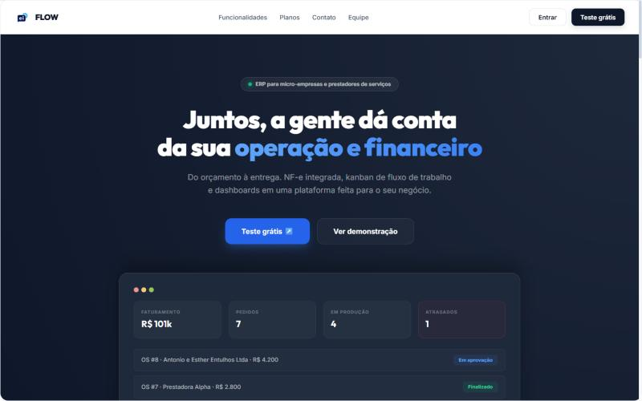
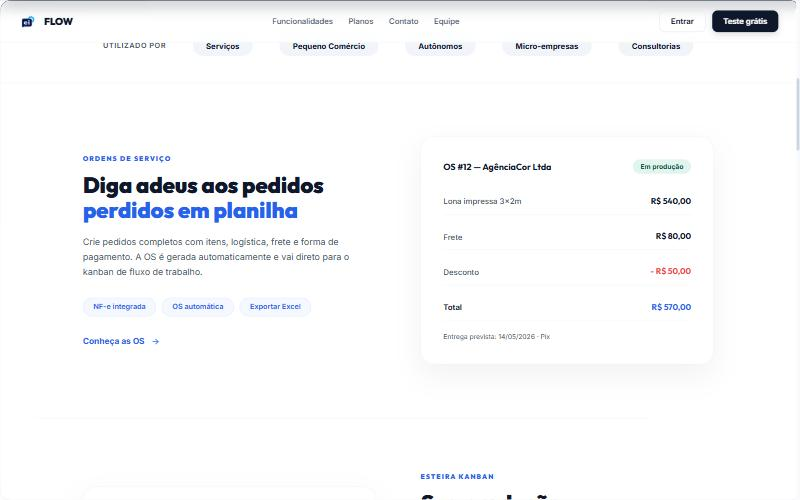
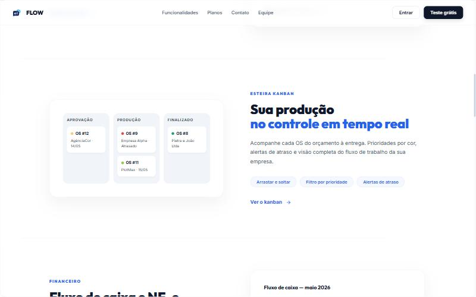
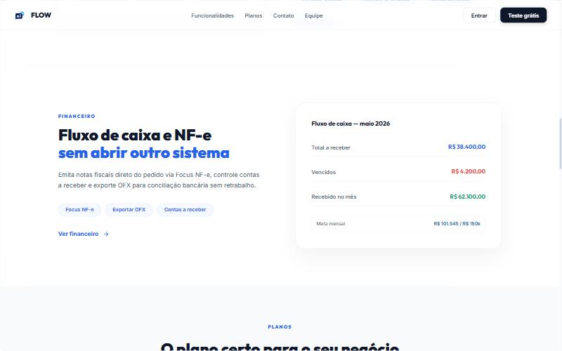
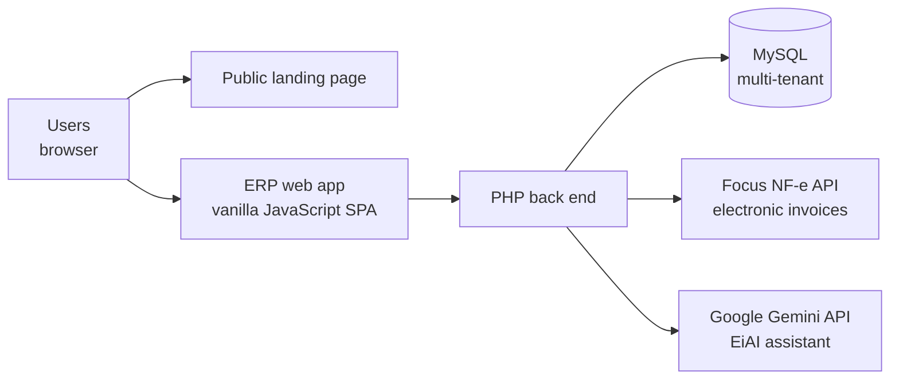

# EI Flow — Case Study

**A multi-tenant SaaS ERP for micro-businesses and service providers**, from quote to delivery: service orders, a production Kanban, Brazilian electronic invoicing (NF-e), cash flow and an AI assistant, in one platform.

Built as the integrative project of the IT Management program at **Fatec Campinas** (Brazil) by a team of 6, which I created and led.

🌐 **Live product:** https://ei.devfatec-campinas.com.br

> The source code is private by agreement with the team. This repository documents the problem, the solution, the architecture and my role in the project.

## The problem

Small businesses and service providers usually run their operation across disconnected tools: orders in spreadsheets, production tracked on paper or WhatsApp, and invoices issued in a separate system. Orders get lost, production delays are noticed late, and the same data is typed two or three times.

Brazilian ERPs such as Bling, Omie and Conta Azul cover the financial side well, but the **production workflow** (what is being made, by whom, and whether it is late) is usually missing or weak.

## The solution

EI Flow connects the whole flow in a single system: **order → service order → production Kanban → invoice → cash flow**. The project started focused on visual communication businesses (print shops) and was later broadened to micro-businesses and service providers in general.

### Service orders

Complete orders with items, logistics, shipping and payment method. The service order is generated automatically and goes straight to the production Kanban.

### Production Kanban

Each service order moves from approval to delivery, with priority colors, delay alerts and drag and drop. **This Kanban-to-invoice workflow is the product's main differentiator.**

### Finance and invoicing

NF-e invoices issued directly from the order (via the Focus NF-e API), accounts receivable, cash flow and OFX export for bank reconciliation.

### Other features

- **EiAI**, an assistant built on the Google Gemini API, with a custom system prompt for the ERP context
- Customers, suppliers, inventory and products
- Dashboards with revenue, orders, production status and late orders
- Excel export
- Subscription plans (Bronze, Silver, Gold) with a 14-day free trial

## Architecture

- **Multi-tenant:** many companies share the same application and database, with every query scoped to the current company
- **Stack:** PHP, MySQL and vanilla JavaScript, deployed on shared hosting with a VPS
- **Integrations:** Focus NF-e for invoicing, Google Gemini for the assistant, reCAPTCHA on public forms

## Security work

Before opening the product to real users, I led several rounds of security audits and fixes. The main issues found and fixed:

- **SQL injection** on several endpoints
- **Cross-site scripting (XSS)**, fixed by escaping output at the injection points
- **Hard-coded database credentials** in the connection file
- **A hard-coded reCAPTCHA bypass**, removed
- **Unsafe file uploads**, fixed with MIME type validation
- **N+1 queries**, replaced with a single aggregated query
- **Schema migrations running inside request handlers**, moved out of the request flow

After the second round of fixes, the system reached an audit score of **8.7/10**. The remaining items (rate limiting on password recovery, generic error messages and server-side file extensions) are documented as next steps.

## My role

- **Created the project and led a team of 6**
- **Product decisions:** chose the Kanban-to-invoice workflow as the differentiator instead of copying every feature of the big ERPs
- **Security:** led the audit rounds and the fixes
- **AI assistant:** designed the EiAI integration and its system prompt
- **Roadmap:** wrote a five-phase product roadmap
- **Infrastructure:** handled the hosting consolidation (shared hosting and VPS)

## What I learned

- Security has to be part of the process from the start: each audit round found issues that would have been cheaper to avoid earlier
- In a small team, deciding what **not** to build matters as much as what to build
- Leading a team means making decisions and keeping everyone aligned, not only writing code yourself

## Team

Developed by a team of 6 students at Fatec Campinas, 2026.

**Octavio Rodrigues Schwab** · project creator and team lead · [GitHub](https://github.com/whoistavs) · [LinkedIn](https://www.linkedin.com/in/octavio-schwab)
